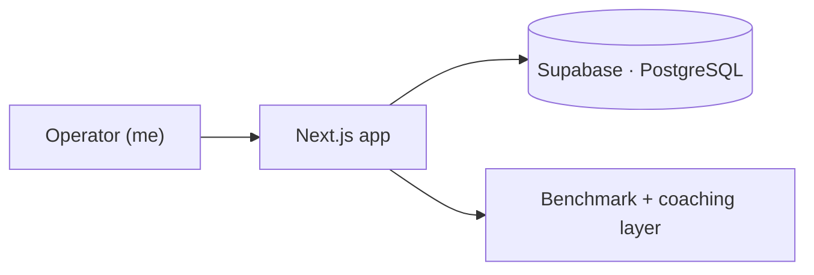

# Founder CRM — Case Study

A relationship-first CRM I built for my own commercial work — founders, consultants, and BD / partnership leads. It's built to answer one question on every screen: **"What's next?"** — and I use it every day.

> ℹ️ The source code is private. This is a write-up of the product and the thinking behind it.
> 🛠️ Built with Claude Code under my direction, from spec to production deploy: I wrote the specs, reviewed every change and owned the architecture and data decisions.

## Problem

Off-the-shelf CRMs are built for large sales teams and quota reporting — not for an individual operator juggling partnerships, business development, and follow-ups. My follow-up discipline lived in my head, so I kept losing momentum on relationships that mattered.

## Solution

A lightweight, **relationship-first** CRM optimized for follow-up discipline and next-actions — plus a **benchmarking and coaching layer** that grades my commercial activity against good practice and nudges me when I'm slipping.

## What it does

- **Every screen surfaces "what's next"** — the next action, not a data dump.
- **Pipeline + relationship tracking** tuned for BD and partnerships, not enterprise quotas.
- **Benchmarks my activity against commercial best practices** and flags where I'm falling short.
- **Self-coaching prompts** — nudges based on cadence, staleness, and follow-through.

## Why this matters (the meta point)

- **I build the tools I need to operate — then dogfood them daily.** The best product feedback loop is being your own hardest user.
- It doubles as a **benchmark**: am I doing the commercial fundamentals well, consistently?
- It shows how I think about **GTM and commercial process**, not just code.

## Architecture (high level)

- **Next.js + TypeScript** app, **Supabase / PostgreSQL** for data and auth.
- Designed for speed and follow-up over feature breadth — a solo-operator tool, not a team CRM.

## Lessons

- **Speed and follow-up beat feature breadth** for a solo operator.
- **A CRM that coaches you** is more useful than one that just stores contacts.
- **Building your own tools sharpens how you advise others** on theirs.

**Stack:** Next.js · TypeScript · Supabase (PostgreSQL)
